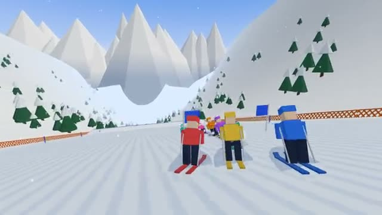

# Downhill Rush

Carve through the flags. Miss one: +3 seconds. A multiplayer starter game from [Multiplayer Agent](https://multiplayeragent.com): 3D, versus, 2–8 players, with bots that fill empty seats.

## How it plays

Everyone skis the same run at once. Carve left and right to pass between each pair of flags, tuck for speed on the straights and fly off the jumps. Each missed gate adds 3 seconds; the fastest time wins.

**Controls:** Arrow keys or A/D to carve, Down or Space to tuck, or on-screen buttons.

## Make it yours in the Game Builder

Open the [Game Builder](https://multiplayeragent.com), choose **Start from a starter game** and pick Downhill Rush. It opens as version 1 in your studio, ready to play and publish. Then ask for changes, for example:

- Add a night run with torches along the slope
- Add coins between the gates that take a second off
- Make it a snowboard race with a halfpipe

## Run it yourself

1. Get a free publishable key (`pk_…`) at [multiplayeragent.com](https://multiplayeragent.com).
2. In `index.html`, put it in place of `pk_REPLACE_ME` in the `MP_CONNECT` block.
3. Serve the folder (for example `npx serve`) and open it. The 3D engine loads as a module, which browsers block from a file on disk.

Without a key it still runs, offline against bots.

## How it is built

- One `index.html` plus three.js in `libs/`. The comment at the top of the script maps the code and explains the multiplayer.
- The run's length, width, steepness and jumps are in `CONFIG`. The gates are new every run: the host picks a seed and every player builds the same gates from it.
- **Leaderboard:** The fastest runs down the mountain.
- **Host-run rounds:** The host's browser starts each run, picks the gates and posts the results; if it leaves, the next player takes over.
- **Bots:** Bots ski with you, and sometimes miss a gate, until enough people join.
- **Live sync:** Every skier carves down the slope for everyone at once.
- `?attract` runs it offline with bots only. The preview video is recorded from it.

## License

MIT. three.js in `libs/` is MIT too (Copyright 2010-2024 three.js authors).
